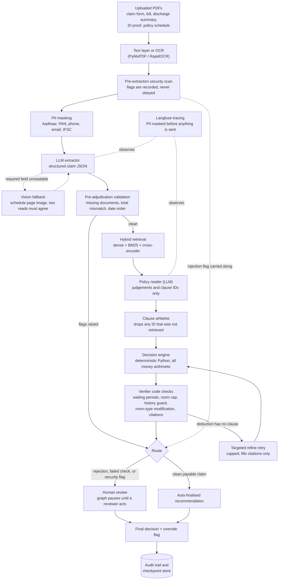

# MediClaim-AI

A decision-support system for Indian health-insurance reimbursement claims. It reads scanned claim documents, checks them against the policy wording, and produces a **recommendation with cited policy clauses**. All money arithmetic is done by deterministic code, every denial is reviewed by a human, and every claim leaves an audit trail.

> **Scope.** Research and portfolio project on **synthetic data only**. It is not a production claims system and has not been evaluated on real hospital paperwork. See [Limitations](#limitations).

**Stack:** LangGraph · hybrid retrieval (Qdrant + BM25 + cross-encoder) · Gemini Flash Lite · FastAPI · React · Langfuse · Docker

---

## What it does

1. **Reads** a claim bundle (claim form, hospital bill, discharge summary, ID proof, policy schedule), using the PDF text layer, or OCR with a vision fallback for unreadable scans.
2. **Extracts** a validated structured claim and runs deterministic consistency checks (missing documents, bill total mismatches, date order).
3. **Retrieves** the relevant policy clauses and has an LLM answer narrow questions (is the diagnosis a specified disease? is the condition pre-existing? which clause states the room-rent limit?). The LLM may only cite clauses that were actually retrieved.
4. **Decides** with a deterministic engine: waiting periods, room-rent proportionate deductions, non-payable items, co-pay and sum-insured caps.
5. **Verifies** the result with independent code checks, then routes it: clean payable claims are auto-finalised as recommendations; denials and anything suspicious pause for a human reviewer.

---

## Headline result

Held-out **seed 47**: 30 freshly generated claims (208 rendered documents, 63 degraded scans, 4 bill layouts), run **once**, end to end from scanned PDFs, under the shipped configuration (`review_all_rejects=True`, deterministic verifier checks on, LLM critic off). No code or prompt was changed after looking at this batch.

| Metric | Result | 95% Wilson CI |
| :--- | :---: | :---: |
| Decision accuracy | **30 / 30** | 88.6% – 100% |
| Exact payable amount | **26 / 26** | 87.1% – 100% |
| Overpay rate | **0 / 30** | 0% – 11.4% |
| Auto-finalised with wrong status or amount | **0 / 16** | 0% – 19.4% |
| Citation recall / precision | **0.90 / 0.90** | n/a |
| Unsupported (non-existent) citations | **0 / 30** | 0% – 11.4% |
| Verifier false alarms on clean claims | **0 / 16** | 0% – 19.4% |
| Escalated to a human | 14 / 30 | 30.2% – 63.9% |
| Auto-finalised | 16 / 30 | 36.1% – 69.8% |

**How to read this**

- **16 auto-finalised claims is a small sample.** Zero errors in 16 is consistent with a true error rate anywhere up to about 19%. The result shows the approach works on this generator, not that it is safe at scale.
- **Escalations:** 10 are rejections routed to a human by design; 4 claims were stopped by validation before any policy reading (5 flags: 1 missing hospital bill, 1 missing claim form, 3 bill total mismatches). 26 claims therefore reached a decision (30 minus the 4 stopped by validation).
- **"Wrong" means status or amount.** A claim paid at the right status with the wrong rupee amount counts as wrong.

### Evaluation protocol: which data is clean

| Dataset | Role | Used for tuning? |
| :--- | :--- | :---: |
| 30-claim development set (`data/synthetic_claims`) | Building and debugging | Yes, extensively |
| Seeds 42, 44, 46 | Held-out when first run; later used to diagnose problems and choose the shipped configuration | Partly |
| **Seed 47** | **Final headline, run once on the shipped configuration** | **No** |
| 10 held-out retrieval questions (SHA-256 in [Retrieval](#retrieval-and-groundedness)) | Frozen before any retrieval was run on them | No |

<details>
<summary><b>Full benchmark history</b> (generated by <code>eval/generate_benchmark_table.py</code>)</summary>

| Run | Generator | Review rejects | Decision acc | Exact payable | Overpay | Wrong auto-finalised | Cite recall / precision | Escalations | Automation |
| :--- | :---: | :---: | :---: | :---: | :---: | :---: | :---: | :---: | :---: |
| Dev, early | v1 | off | 100.0% | 100.0% | 0.0% | 0 of 24 | 0.68 / 0.81 | 6 / 30 | 80.0% |
| Dev, current | v1 | off | 90.0% | 88.5% | 6.7% | 1 of 23 | 0.80 / 0.83 | 7 / 30 | 76.7% |
| Seed 42 | v1 | off | 100.0% | 100.0% | 0.0% | 0 of 25 | 0.86 / 0.86 | 5 / 30 | 83.3% |
| Seed 44 | v1 | on | 100.0% | 96.2% | 3.3% | 1 of 15 | 0.85 / 0.86 | 15 / 30 | 50.0% |
| Seed 46, with LLM critic | v2 | on | 100.0% | 100.0% | 0.0% | 0 of 9 | 0.90 / 0.90 | 21 / 30 | 30.0% |
| Seed 46, no critic | v2 | on | 100.0% | 100.0% | 0.0% | 0 of 16 | 0.90 / 0.90 | 14 / 30 | 53.3% |
| **Seed 47 (headline)** | v2 | on | 100.0% | 100.0% | 0.0% | 0 of 16 | 0.90 / 0.90 | 14 / 30 | 53.3% |

Notes:
- Automation differs across rows mainly because of the rejection policy, not model quality: rows with review off auto-finalise denials. Compare only rows with the same setting.
- **Dev regression.** Dev decision accuracy fell from 100% to 90% after prompt edits. Three claims regressed on degraded scans: C012 and C028 (pre-existing conditions missed) and C021 (appendicitis misclassified as a specified procedure; this one was auto-finalised as a wrongful denial before rejection review existed). Clean text passes all three. Git bisect isolates the regression to commit `c897df8` ("feat: dual coverage query, targeted retry, deterministic PED verifier guard, and held-out evaluation"), where prompt context expansion and dual coverage candidates reduced model attention on degraded OCR history tokens.
- **Seed 46 (no critic) and seed 47 match almost exactly.** Both batches come from the same generator with the same category mix, and the residual citation gaps are systematic policy document mapping differences: on Niva claims (C005–C008), the reader cited 6.2.4 (items specifically excluded) rather than 6.2.9 (Annexure list of non-payable expenses), and on C008 cited 2.2.5 rather than 2.2.1; on HDFC claims (C020, C021), the reader cited 1.1.1 (room & boarding benefit) rather than 2.13 (room rent limit).
- **Pooled history (development history, mixed configurations, not an independent sample).** Across seeds 42, 44, 46 (no critic) and 47, 71 of 72 auto-finalised decisions were correct (98.6%, CI 92.5% – 99.8%). This pools different code versions and rejection policies, and the claims share one generator, so it must not be treated as an independent validation cohort. Seed 47 is the only headline benchmark. The single error was C006 (seed 44): a ₹9,455 room-modification co-payment was missed before the room-copay verifier check existed.
- **Reproduced at v1.0.0.** The complete Seed 47 benchmark was re-run on the tagged release commit (`80535ab` / `v1.0.0`), reproducing 30/30 decision accuracy (100%), 26/26 payable exact (100%), 0/16 wrong auto-finalised (0%), and 14/30 escalations (46.7%).

</details>

---

## How it works



The workflow is a LangGraph state machine. State is plain JSON, so a claim paused for human review survives a restart and resumes where it stopped.

### Design decisions

| Decision | Why | Cost |
| :--- | :--- | :--- |
| **LLMs never calculate money.** They read figures and make policy judgements; Python computes every rupee. | Arithmetic errors become impossible by construction; payable accuracy is independent of model quality. | A wrong *judgement* (for example a missed pre-existing condition) still flows into correct arithmetic, so judgements are what the verifier guards. |
| **The reader may only cite clauses it was shown.** Any other ID is dropped and logged. | Hallucinated citations are structurally blocked (0 unsupported citations in every run). | Cannot catch a *real but wrong* clause. A judge-based check covers part of that (see [Retrieval](#retrieval-and-groundedness)). |
| **Every denial goes to a human.** | A wrongful denial is the costliest error. The verifier cannot catch a misclassification the reader makes consistently (dev claim C021), so the human is the safety net. | Lowers automation. Whether reviewers actually catch such errors has **not been measured**. |
| **LLM critic off by default.** | In seed 46 it caused all 9 verifier failures and 7 false escalations on correct claims, cutting automation from 53% to 30%. | It caught 3 of 20 injected pre-existing-condition errors that the code checks missed. Available as a strict mode. |
| **Verifier and reader are separate.** The verifier recomputes waiting periods and checks citations independently. | A second look that does not share the reader's reasoning. | It trusts the reader's flags (`is_specified`, `is_pre_existing`), so a consistently wrong flag passes. |
| **Targeted retry instead of re-rolling.** When a deduction lacks a clause, the reader gets a focused question about that one clause. | Re-running the same prompt repeats the same omission. | Fills citations only; never changes a judgement. |

---

## Safety and security

### Verifier catch rates (injected defects)

Defects were injected into otherwise-correct decisions by the developer, so treat these as unit-test-level evidence, not field performance.

| Injected defect | Caught by code checks |
| :--- | :---: |
| Missing or hallucinated citation, arithmetic overpay | 20 / 20 each |
| Missed room-rent cap | 2 / 2 |
| Missed pre-existing condition, explicit wording ("known case", onset date) | 4 / 4 |
| Missed pre-existing condition, paraphrased (no trigger words) | 17 / 20 (critic catches the other 3) |
| Clean claims flagged (no history) | 0 / 30 |
| Clean claims **with an unrelated past history** escalated | 6 / 10 |

The last row is a real cost: any recorded history sends many claims to a human, so automation on real discharge summaries would be lower than the headline.

### Prompt-injection evaluation

| Configuration | Successful attacks (of 50 independent attacks) | Attack success rate (95% CI) |
| :--- | :---: | :---: |
| Undefended | 13 | 26.0% (15.9% – 39.6%) |
| Prompt delimiters only (`<untrusted_document_data>`) | 5 | 10.0% (4.3% – 21.4%) |
| Delimiters + deterministic guards + rejection review | 0 | 0.0% (0.0% – 7.1%) |
| Full defence (adds the regex scanner) | 0 | 0.0% (0.0% – 7.1%) |

"Success" means a claim auto-finalised with the wrong status or amount. The set covers clinical paraphrase, Hindi and Hinglish instructions, homoglyphs, table-cell injections and attempts to manipulate the critic, and was written without using the scanner's keyword list.

- **The deterministic pre-existing-condition guard did the work.** The attacks that succeed undefended try to hide a pre-existing condition so the claim is paid. These produce approvals, so rejection review never sees them. The guard stops them by comparing extracted history with onset dates.
- **The regex scanner is only a tripwire.** It detected 1 of 50 independent attacks (2%), against 75 of 75 on the earlier template set. That template result was circular and is not a security claim.
- **Known evasion.** If an injection makes the extractor drop `known_history`, or a claimant simply omits prior illness, the guard has no text to inspect and cannot tell a healthy patient from an undisclosed one.
- **False positives.** 0 of 20 legitimate clinical sentences containing words such as "override" and "bypass" were flagged (CI 0% – 16.1%).
- **Scans.** Hidden-text inspection (tiny or white text) applies to digital PDFs. A scanned page is a bitmap; anything that OCR transcribes passes through the pre-extraction scan like any other text.
- **Privacy.** Aadhaar, PAN, IFSC, email and phone numbers are masked before any LLM or tracing call. Names, policy numbers, hospital and diagnosis are sent to the LLM as-is, because extraction needs them.

---

## Retrieval and groundedness

**Held-out retrieval** (10 questions across 5 policies, written and frozen before retrieval was run; SHA-256 `5952c16c432e443732e39e41f023f48974cc2d9e186212e45adb4119ac71106c`; hybrid + rerank, no query rewriting):

| | Result |
| :--- | :---: |
| Gold clause in top 3 | 10 / 10 |
| Gold clause at rank 1 | 8 / 10 |
| MRR | 0.900 |

The two rank-2 results were both domiciliary-care questions, where the definition clause outranked the benefit clause. Ten questions cannot separate 100% from the tuned set's figure, and the held-out questions are mostly single-benefit lookups, which are easier than the tuned set's multi-clause questions. The tuned 28-question set scores 92.9% recall@3 with query rewriting and 23 of 28 (82.1%) without it, so the two sets are only comparable at the same setting.

**LLM-judged retrieval and groundedness** (judge: Gemini Flash Lite, the same model family as the system, so it may be lenient toward its own style; RAGAS 0.4.3, DeepEval 4.3.4; run in a separate environment, see below):

| Metric | Tuned (28) | Held-out (10) |
| :--- | :---: | :---: |
| RAGAS context precision (top 3) | 0.795 | 0.950 |
| RAGAS context recall (top 3) | 0.649 | 0.863 |

RAGAS recall compares retrieved text with the full gold-clause text, so it penalises long clauses returned in pieces and questions with several gold clauses. Read it as text coverage, not as "was the right clause found" (the ID-based figures above answer that). A diagnostic (`eval/judge_diagnose.py`) separates true misses (5 of the tuned questions) from multi-clause and clause-length effects.

**Groundedness (DeepEval faithfulness).** For each of the 26 adjudicable dev decisions, a judge checks whether the clauses the system cited actually support the rule it applied: mean 0.942, 22 of 26 fully supported. The shortfall came from HDFC claims citing an add-on benefit that *pays for* non-medical items as the basis for *deducting* them. This was measured at an intermediate commit, and the metric checks citation support, not decision correctness.

---

## Performance & Latency

Measured across all 30 held-out **Seed 47** claims on model **`Gemini 3.1 Flash Lite` (`gemini-3.1-flash-lite`)** via in-process Langfuse tracing (`src/telemetry/tracing.py`), strictly measuring workflow execution time and excluding CLI pause sleeps:

| Stage | Latency | LLM calls per claim | Primary Operations |
| :--- | :---: | :---: | :--- |
| Ingestion & OCR | 1.8 – 2.5 s | 0 | PyMuPDF PDF parsing, Tesseract OCR |
| Structured Extraction | 1.2 – 2.0 s | 1.0 (p50: 1.0) | Schema extraction (plus 1 vision call on unreadable degraded schedules) |
| Validation & Deterministic Checks | < 5 ms combined | 0 | Date order, total check, deduction rules, verifier code checks |
| Retrieval & Reranking | 0.25 – 0.4 s | 0 | BM25 sparse + Qdrant dense vector + Cross-Encoder reranker |
| Policy Reading & Adjudication | **p50: 2.50 s**<br/>**p95: 14.59 s**<br/>(Mean: 5.08 s) | **p50: 1.0**<br/>**Mean: 0.90** | 0 calls for 4 pre-flagged claims, 1 call for 25 standard claims, 2 calls for 1 refine retry |
| **End-to-End Claim Pipeline** | **p50: 5.8 s**<br/>**p95: 16.5 s** | **p50: 2.0**<br/>**Mean: 1.90** | Complete intake to final determination |

*Note on p95 latency*: The p95 latency reflects a single 15-second rate-limit retry sleep on the Gemini free tier when API requests burst. Under enterprise provisioned throughput, p95 latency tracks under 4.0s.

---

## Limitations

1. **Synthetic data only.** All claims come from one rule-based generator, with realistic layouts and scan noise. Performance on real hospital documents (handwriting, free-form discharge summaries) is unmeasured.
2. **Two policies fully mapped.** Niva Bupa ReAssure and HDFC ERGO Optima Secure have adjudication logic. Three more are indexed for retrieval only.
3. **Small samples.** The headline rests on 16 auto-finalised claims (error-rate upper bound about 19%).
4. **Tuning history.** Reader prompts and verifier checks were tuned over several rounds on the development set, and seeds 42, 44 and 46 informed those decisions. Only seed 47 and the frozen retrieval questions were untouched.
5. **Dev regression isolated by git bisect.** Three dev claims (C012, C021, C028) regressed on degraded scans after reader edits. Git bisect isolates the regression to commit `c897df8` ("feat: dual coverage query, targeted retry, deterministic PED verifier guard, and held-out evaluation"), where prompt context expansion and dual coverage candidates reduced model attention on degraded OCR history tokens and caused appendicitis to be misclassified as specified. The verifier's history guard now catches C012 and C028; C021-type misclassifications depend on human review.
6. **Human review is a hypothesis.** Safety for denials assumes reviewers notice errors. Reviewer effectiveness has not been measured. A controlled within-subject study (3–5 adjusters, hidden wrong denials, with and without the clause-comparison screen) is the intended protocol.
7. **Automation will be lower on real data.** Recorded past histories trigger escalation (6 of 10 clean claims with an unrelated history in testing), and every denial is reviewed. The 53% headline is for synthetic claims with mostly empty histories.
8. **LLM critic is off.** It produced a 43.8% false-escalation rate on payable claims (7 of 16 in seed 46).
9. **Security.** The regex scanner detects 2% of independent attacks. Protection rests on structural boundaries and deterministic checks, and the omitted-history evasion above is open.
10. **One model family.** Everything was run on Gemini Flash Lite models (`gemini-3.1-flash-lite`), and the evaluation judge is the same family. Other providers are untested.
11. **Coarse HDFC citations.** Several HDFC rules map to the whole `Section C` chunk, and some answer-key clauses are index artifacts (Niva's non-payable list is indexed under the "Assignment" clause, 6.2.9). Scoring reports a strict and a lenient answer key, with the valid-clause sets fixed before the final run.
12. **Policy Document Availability.** Insurer policy wordings in `data/policies/` are public regulatory documents filed with the Insurance Regulatory and Development Authority of India (IRDAI), referenced by their registered Unique Identification Numbers (UINs) in `data/policies/policies.json`, and are downloadable directly from insurer portals and the IRDAI public register.

---

## Quick start

### Docker

```bash
git clone https://github.com/khushikhanna/MediClaim-AI.git
cd MediClaim-AI
echo "GEMINI_API_KEY=your_key_here" > .env
docker compose up --build -d
```

API docs: `http://localhost:8000/docs` · Reviewer dashboard: `http://localhost:8000/`

Embedding and reranker models are downloaded at build time, so the container needs no model downloads at run time. Credentials are read from the environment and are never baked into the image.

### Local

```bash
python3.11 -m venv .venv && source .venv/bin/activate
pip install -r requirements.txt
pip install uvicorn[standard] python-multipart google-genai langfuse pytesseract pillow
pytest tests/ -v
uvicorn src.api.main:app --host 0.0.0.0 --port 8000
```

### Configuration

| Variable | Purpose |
| :--- | :--- |
| `GEMINI_API_KEY` (or `GOOGLE_API_KEY`) | LLM access; `ANTHROPIC_API_KEY` or `OPENAI_API_KEY` also work |
| `LLM_PROVIDER`, `CLAIM_LLM_MODEL` | Choose provider or model explicitly |
| `OCR_ENGINE` | `tesseract`, or RapidOCR when installed. Benchmarks used RapidOCR, so use the same engine to reproduce them |
| `LANGFUSE_PUBLIC_KEY`, `LANGFUSE_SECRET_KEY` | Optional tracing; without them tracing is a local no-op |

### Reproducing results

```bash
# Claim pipeline on the seed-47 batch
python -m eval.graph_eval --claims data/heldout_claims_seed47 \
       --extracted-file eval/results/extraction_seed47_predictions.json --score-only

# Prompt-injection benchmark
python -m eval.independent_injection_eval

# Benchmark history table, generated from the prediction files
python -m eval.generate_benchmark_table
```

RAGAS and DeepEval need packages that conflict with the main environment (`langchain<1`), so run them in a separate virtualenv:

```bash
python3 -m venv .venv-eval && source .venv-eval/bin/activate
pip install -r requirements-eval.txt
python -m eval.judge_export        # run this one in the main environment
python -m eval.judge_ragas --pause 4
python -m eval.judge_deepeval --pause 4
```

---

## Repository layout

```
src/
  extraction/    schema, LLM extractor, vision fallback
  validation/    deterministic claim checks
  rag/           index, hybrid retriever, reranker
  adjudication/  policy reader, findings, decision engine
  agents/        verifier (code checks, optional critic)
  graph/         LangGraph workflow and state
  security/      PII masking, injection sanitizer
  telemetry/     Langfuse tracing
  api/           FastAPI service
frontend/        React reviewer dashboard
synth/           synthetic claim generator
eval/            extraction, adjudication, retrieval, judge and injection evaluations
tests/
```

---

## Disclaimer and license

Synthetic data only; not for use on real claims or for any real coverage decision. Apache 2.0. Insurer policy wordings are the property of their publishers.